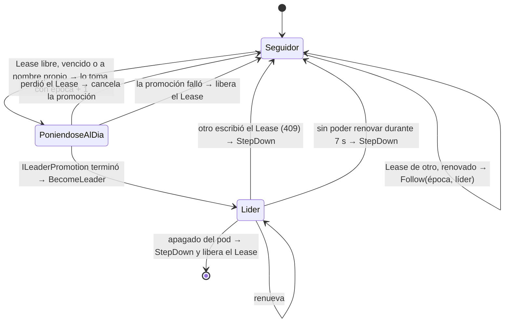

# Coordinación: elección de líder con un Lease (bloque D)

Cómo los 3 brokers se ponen de acuerdo sobre quién es el líder, en qué época, y qué pasa cuando el líder se cae. Corresponde a la fase 4 de [ARQUITECTURA.md](ARQUITECTURA.md). El código está en `src/K0sStreams.Coordination/` y los tests en `tests/K0sStreams.Coordination.Tests/`.

## 1. El problema

Solo un broker puede escribir: si dos asignaran offsets a la vez, los logs dejarían de coincidir. El difícil es el failover: desde afuera no se distingue un líder caído de uno lento o aislado, y si otro broker se declara líder mientras el viejo sigue vivo hay dos líderes (*split-brain*).

El proyecto no implementa consenso propio. Lo delega en Kubernetes:

| Pieza | Qué garantiza |
| --- | --- |
| **Lease** (`coordination.k8s.io/v1`) | En cada momento hay un solo titular oficial. etcd (Raft) lo guarda y lo ordena. |
| **Vencimiento** | Si el titular deja de renovar, a los 10 s otro broker puede tomarlo. |
| **Época** | Si el líder viejo no se enteró de que perdió el Lease, sus escrituras se rechazan (fencing, bloque C). |

## 2. Modos

`AddK0sCoordination` elige el modo al arrancar, sin configurar nada extra:

| Situación | Modo | `IClusterState` |
| --- | --- | --- |
| `Coordination:LeaderId` configurado | Líder fijo (fases 2 y 3, `compose.yaml`) | `StaticClusterState`, época 1 |
| Dentro de Kubernetes, sin `LeaderId` | **Elección por Lease** (fase 4, `deploy/`) | `LeaseClusterState` |
| Fuera de Kubernetes, sin `LeaderId` | Un solo broker, líder (`dotnet run`) | `StaticClusterState`, época 1 |

"Dentro de Kubernetes" lo detecta el cliente de Kubernetes por las variables y el token que Kubernetes monta en todo pod.

## 3. El Lease

```yaml
apiVersion: coordination.k8s.io/v1
kind: Lease
metadata:
  name: k0sstreams-leader
  resourceVersion: "48213"        # lo cambia Kubernetes en cada escritura
spec:
  holderIdentity: broker-0        # titular (NodeId); vacío = libre
  leaseDurationSeconds: 10
  renewTime: "2026-10-22T14:03:07.000000Z"
  leaseTransitions: 4             # la época
```

**Compare-and-swap.** Cada reemplazo (`PUT`) lleva el `resourceVersion` que se leyó. Si otro escribió desde entonces, el API server responde 409 Conflict y el cambio no se aplica. Por eso, de dos brokers que intentan tomar el Lease a la vez, gana uno solo. El código no programa ese candado: lo traduce (`KubernetesLeaseStore` devuelve `null` ante un 409).

**La época es `leaseTransitions`.** Quien toma el Lease lo escribe con `leaseTransitions + 1`, con compare-and-swap. Consecuencias:

- Cada época tiene un solo dueño, porque solo una escritura con ese número puede ganar.
- Cualquier broker, incluso recién reiniciado, conoce la época vigente leyendo el Lease. No hace falta guardarla en otro lado.

Son dos de las condiciones que el contrato `ILeaderPromotion` le pide a la coordinación.

## 4. El bucle de elección

`LeaderElector` es un `BackgroundService`: ASP.NET lo arranca con el broker y lo detiene al apagarlo. Cada `RetryPeriod` (2 s) corre un ciclo (`TickAsync`):



| Paso | Detalle | Dónde |
| --- | --- | --- |
| Seguir | Anota la época y el titular, y avisa con `EpochChanged` si la época cambió | `LeaseClusterState.Follow` |
| Vencimiento | Se mide con el **reloj local**: cuánto pasó desde que *vio* cambiar el `resourceVersion`. No compara `renewTime` con su reloj, porque los relojes de los pods pueden no coincidir. | `LeaderElector.TryTakeAsync` |
| Lease a nombre propio | Era el líder y se reinició: lo retoma ya, con una época nueva | `LeaderElector.TryTakeAsync` |
| Ponerse al día | Corre en segundo plano, porque puede tardar más de 10 s y mientras tanto hay que seguir renovando | `LeaderElector.StartPromotion` |
| Pasar a líder | Recién cuando terminó la promoción y el Lease sigue siendo propio | `LeaderElector.PromoteAsync` |
| Bajarse | `StepDown` deja `IsLeader = false` y avisa: la replicación deja de confirmar escrituras | `LeaderElector.LoseLease` |
| Apagado | Libera el Lease en vez de dejarlo vencer: el siguiente líder sube enseguida | `LeaderElector.StopAsync` |

**Error del API server o respuesta 409.** Un 409 al renovar es una respuesta segura: el Lease es de otro, así que el líder se baja enseguida. Una excepción (API server caído, red) es "no sé", así que aguanta hasta `RenewDeadline` antes de bajarse.

## 5. Los tiempos

| Opción | Valor | Para qué |
| --- | --- | --- |
| `RetryPeriod` | 2 s | Cada cuánto se renueva (líder) o se mira (seguidor) |
| `RenewDeadline` | 7 s | Cuánto aguanta un líder sin poder renovar |
| `LeaseDuration` | 10 s | Cuánto espera un seguidor antes de tomar un Lease sin renovar |

La regla es **`RetryPeriod < RenewDeadline < LeaseDuration`**, y el broker no arranca si no se cumple (`ValidateOnStart`).

`RenewDeadline < LeaseDuration` es lo que evita dos líderes: un líder aislado se baja a los 7 s, antes de que otro pueda tomar el Lease a los 10 s. Si igual pasara (por ejemplo, un proceso congelado), el fencing por época de la replicación rechaza al viejo.

**Failover en el peor caso** (el líder muere sin apagado limpio): 10 s de vencimiento + hasta 2 s hasta el siguiente ciclo + la promoción, que copia lo que falte. Son unos 12–13 s, dentro de los 15 s del criterio de la fase 4. Con apagado limpio (`kubectl delete pod`) el líder libera el Lease y el siguiente lo toma en el próximo ciclo, ≤ 2 s.

## 6. Contrato con Replicación (`ILeaderPromotion`)

La replicación (C) implementa `ILeaderPromotion`; la coordinación la llama. El contrato (`src/K0sStreams.Contracts/ILeaderPromotion.cs`) pide, y el elector cumple:

| Condición | Cómo se cumple |
| --- | --- |
| Llamarla con `IsLeader` todavía en `false` | `BecomeLeader` recién se llama después de que `PromoteAsync` termina |
| Después, `IsLeader = true`, época nueva y `EpochChanged` | `LeaseClusterState.BecomeLeader` |
| Cancelarla si se pierde el Lease | `LoseLease` cancela el `CancellationTokenSource` de la promoción |
| Cada época para un solo broker, y la época del Lease en todos | Época = `leaseTransitions`, escrita con compare-and-swap |
| No tomar `ILeaderPromotion` en el constructor del `IClusterState` | El estado (`LeaseClusterState`) y el bucle (`LeaderElector`) son clases separadas |

Si la promoción falla, normalmente es porque algún broker ya está en una época mayor. El elector libera el Lease, y como cada intento usa una época más, los intentos terminan superándola.

## 7. Mapa del código

| Archivo | Qué hace |
| --- | --- |
| `ServiceCollectionExtensions.cs` | Elige el modo y registra todo |
| `CoordinationOptions.cs` | Sección `Coordination`: nombre del Lease, tiempos, formato de la dirección del líder |
| `LeaseClusterState.cs` | `IClusterState`: rol, época y líder. No sabe nada de Kubernetes |
| `LeaderElector.cs` | El bucle de elección |
| `ILeaseStore.cs` | Lo que el bucle le pide al Lease: leer, crear, reemplazar con compare-and-swap |
| `KubernetesLeaseStore.cs` | Esas tres operaciones contra el API server |

Tests:

| Archivo | Qué prueba |
| --- | --- |
| `LeaseClusterStateTests.cs` | Cada transición del estado y el orden del aviso |
| `LeaderElectorTests.cs` | Cada historia de la elección, con reloj falso (`FakeTimeProvider`) y Lease en memoria (`Support/FakeLeaseStore`) |
| `KubernetesLeaseStoreTests.cs` | HTTP y JSON reales del cliente de Kubernetes contra un API server de juguete (`Support/FakeLeaseApiServer`) |
| `LeaseRegistrationTests.cs` | El registro y la validación de los tiempos |
| `LiderFijoTests.cs` | El modo de líder fijo |

## 8. Configuración y despliegue

| Clave | Por defecto | En `deploy/` |
| --- | --- | --- |
| `Coordination__LeaseName` | `k0sstreams-leader` | — |
| `Coordination__LeaseDuration` | `00:00:10` | — |
| `Coordination__RenewDeadline` | `00:00:07` | — |
| `Coordination__RetryPeriod` | `00:00:02` | — |
| `Coordination__LeaderAddressFormat` | sin valor (no se puede redirigir al líder) | `http://{0}.broker:9090` |
| `Coordination__LeaderId`, `Coordination__LeaderAddress` | sin valor | Solo en `compose.yaml` (líder fijo) |

`deploy/rbac.yaml` le da al pod la identidad `broker` (ServiceAccount) con permiso de `get`, `create` y `update` sobre `leases`, uno por cada operación de `ILeaseStore`. El RoleBinding nombra el namespace `default`: si se despliega en otro, hay que cambiarlo ahí.

## 9. Cómo probarlo

Tests del bloque:

```bash
dotnet test tests/K0sStreams.Coordination.Tests
```

Failover en minikube (los pasos para levantarlo están al principio de `deploy/broker.yaml`):

```bash
kubectl get lease k0sstreams-leader -w                 # terminal 1: el titular en vivo
kubectl get lease k0sstreams-leader \
  -o jsonpath='{.spec.holderIdentity} {.spec.leaseTransitions}{"\n"}'   # titular y época
kubectl logs broker-0 | grep -E "Lease|Líder"          # lo que decidió cada broker

kubectl delete pod <líder>                             # apagado limpio: otro lo toma en ≤ 2 s
kubectl delete pod <líder> --grace-period=0 --force    # caída: otro lo toma en ~10–12 s
```

## 10. Límites conocidos

- **No borrar el Lease a mano.** Uno nuevo vuelve a empezar en la época 1, por debajo de la de los logs. El sistema se recupera solo (cada promoción fallida libera el Lease y el siguiente intento sube la época), pero tarda un ciclo por cada época que tiene que recuperar.
- **Lecturas de un seguidor.** Un seguidor sigue la época del Lease, pero sus datos pueden estar un poco atrasados respecto del líder (tema abierto 4 de [contexto.md](contexto.md)).
- **Lo que pasa al cambiar de líder fuera de este bloque** (reconstruir la cola, conocer los tópicos) depende de que A y B escuchen `EpochChanged`. Ver los pendientes en el PR de la fase 4.
