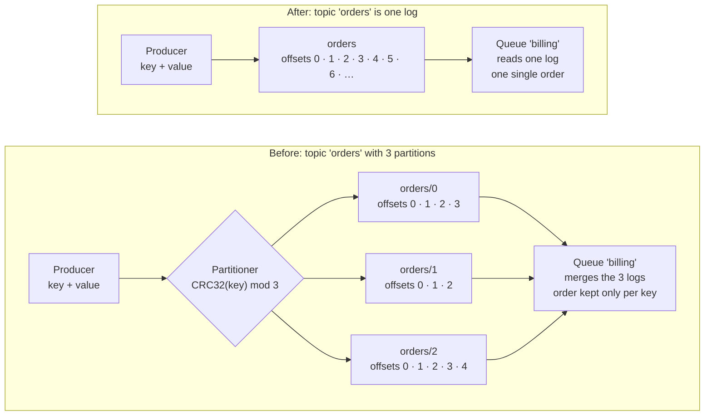
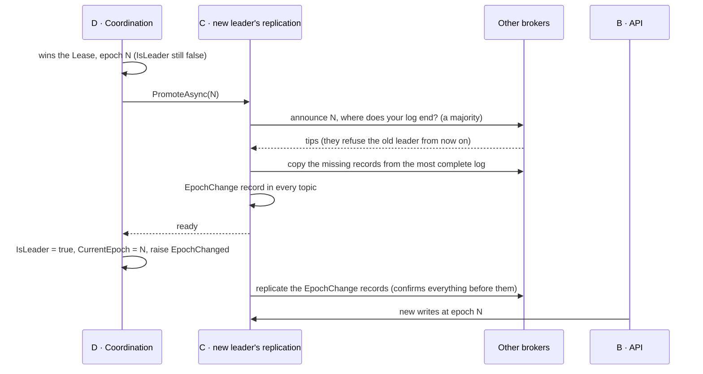

# Decision log

Decisions that change the scope, the contracts or the design of K0sStreams. Each entry says why it was taken, what it changes in each block, and what was left for later. Add new entries at the end, with the next number.

---

## DEC-001 · One partition per topic: remove partitions

| | |
| --- | --- |
| Date | 7 Oct 2026 |
| Proposed by | C, Replication |
| Status | Decided by C. Replication side done (8 Oct 2026). Changes to `Contracts` need the team's agreement (repo rule 3), in one grouped PR. |

### Context

Partitions split one topic into several independent logs, so it can be written and read in parallel. Systems like Kafka also spread them across brokers. Order is kept only within a partition, so messages with the same key always go to the same one.

In K0sStreams that benefit mostly doesn't apply. The one broker holding the Lease leads **every** partition, so partitions add no cross-broker scaling. They only add parallelism inside the leader. Meanwhile the concept runs through every contract, the REST routes, the queue events, the on-disk layout and the tests, and everyone has to reason about it. It was already third on the team's cut list.

This is an educational project. What it needs to demonstrate is quorum replication, epochs and fencing, failover and the log-that-is-also-a-queue, and none of that depends on partitions.

### Decision

**A topic is a single log.** Partitions are removed completely, not kept as a field fixed at 0: from the contracts, the gRPC protocol, the REST API, the queue events and the on-disk layout.

### With and without partitions

| | With partitions | Without |
| --- | --- | --- |
| A message is identified by | topic + partition + offset | topic + offset |
| Read as history | `GET /v1/topics/orders/partitions/1/messages?from=0` | `GET /v1/topics/orders/messages?from=0` |
| Ack | `POST .../queues/billing/ack/1/42` | `POST .../queues/billing/ack/42` |
| Order | Per partition (per key) | The whole topic |
| Who leads it | The Lease holder leads all three partitions | The Lease holder leads the one log |

The last row is the key point. In "before", the three partitions all live on the same leader, so splitting the topic doesn't spread any load across brokers.

### What changes

| Where | Change |
| --- | --- |
| `ILog` | Drop the `partition` parameter from all six methods. |
| `IReplicator` | `WaitForQuorumAsync(topic, offset)`. |
| `IQueueEngine` | `AckAsync` and `NackAsync` drop `partition`; `Delivery` and `DeadLetter` drop `Partition`. |
| `QueueEvent` | Drop `Partition`. The event value becomes `targetOffset int64 \| untilMs int64 \| reason`. This changes the on-disk format, which is safe now because nothing has been stored yet. |
| `TopicConfig` | Drop `Partitions` and `MaxPartitions`. |
| `Partitioner` | Delete it, along with `PartitionerTests`. |
| `Api/Dtos.cs` | `CreateTopicRequest` and `TopicResponse` drop `Partitions`; `PublishResponse`, `DeliveryResponse` and `DeadLetterResponse` drop `Partition`. |
| `replication.proto` | Remove `partition` from `AppendRequest`, `FetchRequest` and `StateRequest`, and mark those field numbers `reserved`. |
| Fakes | `InMemoryLog` keyed by topic only; `InstantReplicator` follows `IReplicator`. |
| **A**, Storage | One folder per topic, with no partition level. |
| **B**, Queue and API | Read becomes `GET /v1/topics/{t}/messages?from=&max=`. Ack and nack become `/v1/topics/{t}/queues/{q}/ack/{offset}` and `.../nack/{offset}`; the `fix/ack-nack-partition-en-ruta` branch is no longer needed. Consuming no longer merges partitions. |
| **C**, Replication | ✅ Done. Validation and locks are per topic. `SingleLog.cs` pins partition 0 and rejects any other until the contracts change; then that file is deleted. |
| **D**, Platform | The `Topic` CRD has no `partitions` field. |
| Docs | README, ARQUITECTURA.md, contexto.md and the replication docs drop partitions from routes, examples and diagrams. |

### Consequences

**Gains**

- Simpler contracts, API, queue engine and tests, with one less concept to explain in the defense.
- **A stronger ordering guarantee:** every consumer sees all of a topic's messages in one single order, not just per key.

**Losses**

- A topic's throughput is capped by one log (one write path and one group commit on the leader).
- No parallelism within a topic. Anyone who needs it can use several topics (`orders-1`, `orders-2`…) and route between them on the client side.

### Alternatives considered

- **Keep `partition` everywhere, fixed at 0.** No contract churn, but the concept stays in every signature, route and test, and has to be explained anyway. Rejected: the point is to simplify.
- **Keep partitions as designed.** Rejected: the complexity is real and the benefit doesn't apply while one broker leads everything.

### Future improvement

Partitions come back only if the project needs to scale beyond one log per topic. Done properly, that would mean:

1. Bring back `partition` in `ILog`, `IReplicator`, `IQueueEngine`, the proto (with new field numbers) and the REST routes, plus a key-based partitioner.
2. **A leader per partition** (one Lease each), spread across the brokers. Without this, partitions add complexity but no real scaling.
3. Consumers that read a topic across its partitions, with order kept only per key.

Worth mentioning in the defense as the way the design would scale.

### Next steps

1. Agree on this with the team and merge one PR to `Contracts` with all the contract changes above.
2. Each block adapts in its own branch. For replication it's a small change, done right after the Contracts PR.
3. Update the docs listed above.

### Update (implementación)

El contrato conserva `Partitions` para no romper firmas, rutas ni tests. La implementación usa **un solo log por tópico**: `SegmentedLog` indexa por nombre de tópico, el motor de cola trabaja sobre la partición 0 y el productor calcula una partición con el partitioner, pero el almacenamiento no la separa. En la práctica hay una sola partición lógica y no hay líderes por partición.

Precisión: el valor por defecto de la CRD es `partitions: 1`, no 0. “0 particiones” no existe como valor; lo que existe es un log único y la partición 0. El líder del cluster es, por lo tanto, el líder de esa partición 0 en cada tópico.

---

## DEC-002 · Promote a new leader instead of truncating to the high watermark

| | |
| --- | --- |
| Date | 14 Oct 2026 |
| Proposed by | C, Replication |
| Status | Implemented on `feature/replicacion` (replication iteration 3). Needs the team's approval before merging: it changes `Contracts` and the failover plan in ARQUITECTURA.md. |

### Context

ARQUITECTURA.md says that on a failover the new leader "trunca lo que no estaba confirmado por quórum" (Flow 4, step 4), and the phase-4 row gives A "truncar al cambiar de época". contexto.md says `EpochChanged` tells A to truncate. That loses confirmed messages, in two ways ([replication.md §10.1](replication.md#101--failover-as-currently-described-can-lose-confirmed-messages-c-d-a)):

1. **A broker's HW lags.** A follower learns the high watermark one round after the leader. Truncating to its own HW deletes records a producer already got a `201` for.
2. **The Lease can go to a broker that is behind.** It would then overwrite confirmed records on the others.

### Decision

**No broker truncates on an epoch change.** Before announcing itself, a new leader runs a promotion step, exposed to D as `ILeaderPromotion`. For every topic:

1. **Survey.** Announce the new epoch to a majority, which then refuses the old leader, and learn where each log ends.
2. **Catch up.** Copy what the most complete of those logs has and this one lacks.
3. **Mark.** Write an `EpochChange` record. Once it's replicated to a majority, it confirms everything before it.

Only followers truncate, and only when the leader's `Append` shows them a divergent tail. They never truncate a confirmed record.

### What changes

| Where | Change |
| --- | --- |
| `Contracts` (own PR) | New `ILeaderPromotion` (`PromoteAsync(newEpoch)`), with D's obligations in its XML doc. New `ListTopics` RPC in `replication.proto`. Both additive. |
| **A**, Storage | Don't truncate on `EpochChanged`; only on replication's request. Next Contracts batch: a way to list the topics in `ILog`, so a broker knows its topics after a restart. |
| **B**, Queue and API | Skip `RecordType.EpochChange` records in history reads and queues: they aren't messages. Only write while `IsLeader`, stamping `CurrentEpoch` at append time. Around a failover, `WaitForQuorumAsync` throws `NotLeaderException` (307 or 503). |
| **C**, Replication | ✅ Done (iteration 3). |
| **D**, Coordination | On winning the Lease:<ul><li>call `PromoteAsync(newEpoch)` while `IsLeader` is still false;</li><li>then set `IsLeader = true` and `CurrentEpoch`, and raise `EpochChanged`;</li><li>cancel the token if the Lease is lost meanwhile.</li></ul>Also:<ul><li>give each epoch to one broker only, and report the Lease's epoch on every broker, including after a restart;</li><li>keep renewDeadline < leaseDuration, so an old leader drops `IsLeader` before the Lease can move;</li><li>resolve `ILeaderPromotion` lazily (e.g. from the elector), not in `IClusterState`'s constructor.</li></ul> |
| Docs | ARQUITECTURA.md (Flow 4 and the phase-4 rows) and contexto.md (`EpochChanged`): their owners update them after approval. |

### Consequences

**Gains**

- No confirmed record is lost on failover; the scenario of a lagging broker becoming leader is a passing test.
- The old leader is fenced at the survey, before the new leader writes anything, and can't confirm anything afterwards.

**Costs**

- A promotion needs a majority to answer and waits otherwise. No leader is better than one that may lose data.
- Each failover costs one round of calls per topic, done topic by topic.
- `KnownTopics` lives in memory. If two brokers restart before a topic gets a new write, a new leader may not know that topic. The fix is the `ILog` topic listing above.

### Alternatives considered

- **Truncate to the HW on an epoch change** (the current plan). It loses confirmed records (see Context).
- **New proto fields `StateRequest.epoch` and `StateResponse.last_epoch`** (the first proposal in replication.md §10.1). `GetState` doesn't take the topic's lock, so it can race with an append the old leader still has in flight. An empty `Append` at the new epoch takes that lock, and needs no field. The last record's epoch comes from `Fetch(end_offset, 1)`.
- **Only "in-sync" brokers may take the Lease** (Kafka's ISR). It needs the in-sync set stored somewhere consistent, which is more work for D, and the new leader still has to catch up.

---

## DEC-003 · Store the topic catalog in the log

| | |
| --- | --- |
| Date | 22 Oct 2026 |
| Proposed by | D, Platform and coordination |
| Status | Agreed with A and B, who asked D to implement it. Done on `fix/failover-state`. |

### Context

The topic catalog lived only in memory (`InMemoryTopicCatalog`, open issue 1 in contexto.md). With failover working (phase 4), that showed up right away: after a restart or a leader change, the new leader didn't know any topic and the API answered 404 for every one, although their messages were on disk and replicated.

### Decision

**Each created topic is a record in an internal topic, `k0s.topics`, in the same log as the messages.** Creating a topic appends the record (key: the name; value: the `TopicConfig` as JSON) and waits for the quorum, like publishing. Any broker builds its in-memory copy by reading `k0s.topics` up to the high watermark: a restarted broker, a follower, or a new leader.

- The internal topic needs a valid name, because replication rejects the rest (`TopicConfig.IsValidName`). So `k0s.topics` is reserved: creating a topic with that name answers 409.
- `ITopicCatalog.Find` is synchronous, so on an unknown name it reads the new records of `k0s.topics` blocking. The internal topic has one record per topic, so it stays small.
- A topic exists once its creation has a quorum, like a message.

### What changes

| Where | Change |
| --- | --- |
| **A**, Storage | New `LogTopicCatalog`, registered instead of `InMemoryTopicCatalog` (which stays as a fake for tests). It needs `IReplicator` and `IClusterState`. |
| **B**, API | Creating a topic goes to the leader (307 from a follower), like every other write. |
| Contracts | Nothing. |

### Alternatives considered

- **Derive the topics from the logs on disk.** Simpler, but the configuration the client asked for (`maxRetries`, `retryBackoff`) would be lost.
- **A file next to the log.** Breaks "everything on disk goes through `ILog`", and would need its own replication.

---

## DEC-004 · Delivery state is ephemeral; only the cursor and the DLQ are durable

| | |
| --- | --- |
| Date | 6 Nov 2026 |
| Proposed by | B, Queue and API |
| Status | Accepted and implemented on `fix/original-scope` (merged to `main`). |

### Context

The original queue engine stored every delivery transition (`receive`, `ack`, `nack`, `timeout`) as a record in the same log as the messages, replicated by quorum. Consuming one message therefore cost three confirmed writes:

1. the publish (leader + follower fsync),
2. the `Receive` event,
3. the `Ack` event.

The log also grew with consumption instead of traffic, and rebuilding the queue depended on the whole delivery history.

### Decision

Delivery state (leases, visibility, attempt counts, scheduled retries) lives in the leader's memory. The only durable queue state is:

- the committed cursor per queue/partition, written as `OffsetCommit` records in batches (about once per second), and
- DLQ markers.

`receive` and `ack` no longer write to the log. If the leader changes, unacknowledged deliveries are redelivered: the guarantee is at-least-once. The cursor advances only over the contiguous acknowledged prefix, never over a gap.

### Consequences

- A message costs about one confirmed write (the publish) plus amortized cursor commits, instead of three.
- The log grows with traffic, not with consumption.
- A failover can redeliver messages acknowledged since the last cursor flush (up to ~1 s).
- Exact reconstruction of in-flight state is lost; redelivery replaces it.
- `Apply` only replays `OffsetCommit` and DLQ markers; legacy delivery events are ignored.

### Alternatives considered

- **Commit the cursor on every ack.** Stronger durability window, but returns to a per-message quorum write and loses the throughput gain.
- **Keep event sourcing for delivery state.** The previous design: exact reconstruction, at three writes per message and unbounded history.

---

## DEC-005 · Segment retention: delete by age or size, and remember where the log starts

| | |
| --- | --- |
| Date | 7 Nov 2026 |
| Proposed by | A, Storage |
| Status | Implemented on `fix/storage-retention`. Nothing outside `K0sStreams.Storage` changes; the `Retention` section and its three keys stay exactly as the chart uses them. |

### Context

Retention arrived with commit `9d7a73b` (3 Nov 2026) so the demo would not fill its disk. A task inside `SegmentedLog` woke up every `Retention:CheckInterval` and deleted old segments, and the Helm chart turns it on by default (`MaxAge 24:00:00`, `MaxBytes 1 GiB`, `CheckInterval 00:05:00`).

It deleted the right kind of thing for the wrong reasons, and the log could not come back afterwards:

1. **Age was never measured.** `DeleteOldSegmentsByTimeAsync` took a cutoff and never compared it to anything: it deleted every segment before the one holding the high watermark, whatever its age. With `MaxAge` at a day, segments minutes old were deleted.
2. **Size was not measured either.** The same shortcut in `DeleteOldSegmentsBySizeAsync` deleted everything below the high watermark regardless of `MaxBytes`.
3. **A pruned topic did not survive a restart.** `RebuildIndex` required the first segment to start at offset 0, so after deleting it the next start treated the topic as damaged and refused to serve it at all.
4. **Reading below what was deleted was undefined.** `PlanRead` returned an empty plan, so a consumer asking for a deleted offset got zero records and could not tell that from reaching the end of the log.
5. **A reader could race a delete.** The plan was built under the topic's lock, but the files were opened after releasing it.
6. **Time came from `DateTimeOffset.UtcNow` and a `PeriodicTimer` with no `TimeProvider`**, which the repo rules forbid and which made the whole thing untestable.
7. The task was started from `SegmentedLog`'s constructor, with a blocking `Dispose`, empty `catch` blocks and two broken XML comments.
8. There was not one test.

### Decision

Keep the idea — delete old segments by age or by size — and make it safe.

| | What |
| --- | --- |
| **A** | Never delete the active segment, the one holding the high watermark, or anything after it. Unconfirmed records are never deleted, so with nothing confirmed nothing is deleted. |
| **B** | By age: delete a segment only when its **newest** record is older than `MaxAge`. Each `Segment` remembers the newest timestamp it has seen, updated both when writing and when scanning on recovery, so a pass costs no disk reads. |
| **C** | By size: delete the oldest segments until the topic fits in `MaxBytes`, using the length each segment already knows. |
| **D** | Before deleting anything, write the first offset that will remain to a small `log-start` file in the topic's folder (temp file, `fsync`, atomic rename, `fsync` of the folder), and only then delete the `.log` and `.index` files. On recovery: with `log-start`, the first segment must start there and that is where the log starts; segments left entirely below it (a power cut mid-delete) are deleted now and recovery continues; without `log-start`, the old rule holds and the first segment must start at 0. A real gap between segments is still damage. |
| **E** | Reading from an offset below the start of the log returns from the start instead of returning nothing. `ILog` does not change: this is internal behaviour. |
| **F** | If a planned segment is gone by the time it is opened, the read is re-planned from the current start of the log instead of failing. An already-open file keeps working on Linux even if it is deleted. |
| **G** | Retention no longer runs inside the log. `SegmentedLog` exposes one internal method that applies retention once, for a given instant, and a small `RetentionService` (`BackgroundService`) calls it every `CheckInterval` with a `PeriodicTimer` and the injected `TimeProvider`, honouring the host's `CancellationToken`. Disk errors are logged with `ILogger` and the next round retries. |
| **H** | The `Retention` section and its keys (`MaxAge`, `MaxBytes`, `CheckInterval`) keep their names, meaning and format. Both limits empty means retention is off, including when they arrive as empty environment variables. |
| **I** | Deletion always goes oldest first and never leaves a hole. |

### What changes

| Where | Change |
| --- | --- |
| **A**, Storage | All of the above, plus 16 tests in `RetentionTests.cs` covering age, size, protection of the high watermark, recovery after deleting, an interrupted delete, a real gap, reading below the start, a read racing a delete, and the configuration. |
| **B**, Queue and API | Nothing to do. One behaviour to know: asking for an offset retention already deleted now returns records from the start of the log instead of an empty page. A consumer whose cursor fell behind retention skips forward instead of stalling. |
| **C**, Replication | Nothing to do, but see the known limit below. |
| **D**, Platform | Nothing to do: no new keys, no new projects, no changes under `deploy/`. One thing worth checking, below. |
| Contracts | Nothing. |

### Known limit for C, Replication

Each broker applies retention on its own, over the topics it has open. A follower that falls far behind can ask the leader for an offset the leader has already deleted, and replication today has no way to skip forward to the start of the log. With a day or a gibibyte per topic this should not happen during the demo, but it is a real hole in the design, and the fix belongs to replication (answer "that offset is gone, start at N" and let the follower jump).

### Something for D to check

The chart sets `retention.maxAge: "24:00:00"`, and the README reads it as 24 hours. .NET parses that string as `d:hh:mm`, so it binds to **24 days**, not 24 hours: 24 is not a valid hour. In practice only the size limit is doing anything in the deployed chart. Twenty-four hours is written `"1.00:00:00"`. The value lives in `deploy/helm/k0sstreams/values.yaml` and `src/K0sStreams.Broker/appsettings.k8s.json`, which belong to other blocks, so Storage only pinned the current behaviour in a test.

### Consequences

**Gains**

- A segment is deleted only once every record in it is older than `MaxAge`, or only when the topic does not fit in `MaxBytes`.
- A topic survives retention plus a restart, plus a power cut in the middle of a delete.
- A consumer or a replica that asks for a deleted offset gets served from the start of the log instead of an error or an empty answer.
- Retention is testable, and the pod shuts down cleanly because the loop belongs to the host.

**Costs**

- One more small file per topic (`log-start`), and two `fsync` calls each time segments are deleted.
- Each segment carries one extra `long` in memory.
- Retention only covers the topics this broker has opened since it started. A topic nobody has touched since the last restart is not cleaned up until someone reads or writes it. For the demo that is enough; scanning the data directory would mean recovering every topic at startup, which the Kubernetes probes do not allow.
- After a truncation, a segment keeps the newest timestamp it ever saw, which can be newer than what it still holds. That errs towards keeping the segment longer, never towards deleting it too early.

### Alternatives considered

- **Read the last record of each segment on every pass** instead of remembering the newest timestamp. Correct, but it turns a cheap pass into one disk read per segment per topic every five minutes.
- **Derive the start of the log from the first segment's file name**, with no `log-start` file. Simpler, but then a first segment lost to real damage is indistinguishable from one deleted on purpose, and the recovery check that catches gaps would have to go.
- **Delete the whole prefix below the high watermark**, which is what the code did. It is not retention: it deletes confirmed data as soon as it is confirmed, whatever the configuration says.
- **Keep the loop inside `SegmentedLog`.** Rejected: the log would own a task nobody can stop, and the time could not be faked.
