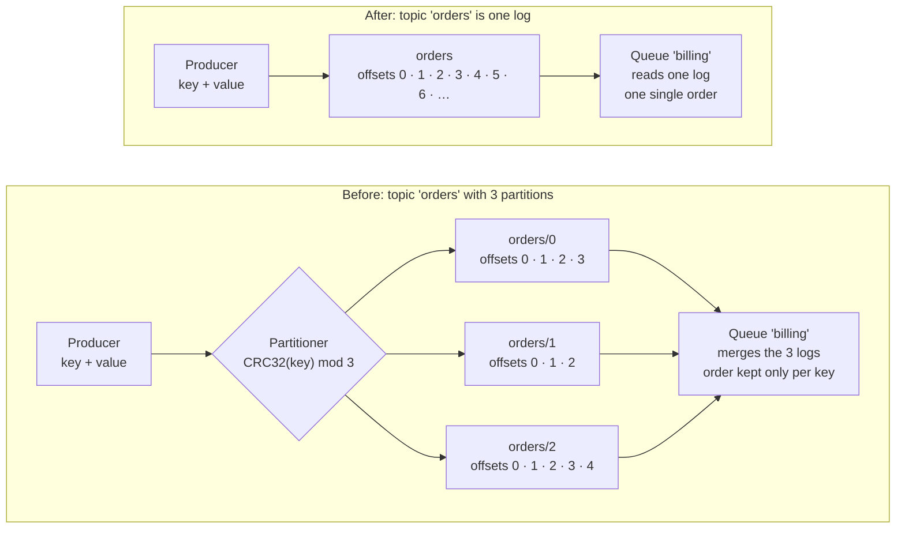
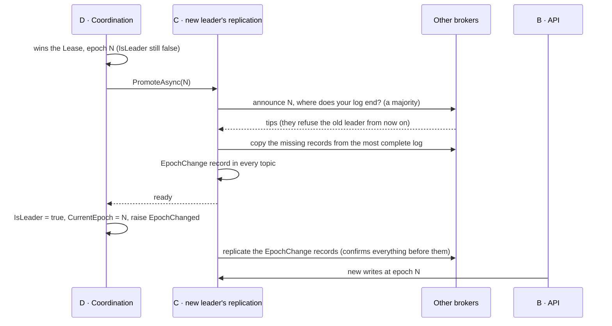

# Decision log

Decisions that change the scope, the contracts or the design of K0sStreams. Each entry says why it was taken, what it changes in each block, and what was left for later. Add new entries at the end, with the next number.

---

## DEC-001 · One partition per topic: remove partitions

| | |
| --- | --- |
| Date | 7 Oct 2026 |
| Proposed by | C, Replication |
| Status | **Superseded (5 Nov 2026).** This was a temporary simplification for an earlier increment; the final scope kept the original multi-partition design. The decision below is kept for history. |

### Context

Partitions split one topic into several independent logs, so it can be written and read in parallel. Systems like Kafka also spread them across brokers. Order is kept only within a partition, so messages with the same key always go to the same one.

In K0sStreams that benefit mostly doesn't apply. The one broker holding the Lease leads **every** partition, so partitions add no cross-broker scaling. They only add parallelism inside the leader. Meanwhile the concept runs through every contract, the REST routes, the queue events, the on-disk layout and the tests, and everyone has to reason about it. It was already third on the team's cut list.

This is an educational project. What it needs to demonstrate is quorum replication, epochs and fencing, failover and the log-that-is-also-a-queue, and none of that depends on partitions.

### Decision

**A topic is a single log.** Partitions are removed completely, not kept as a field fixed at 0: from the contracts, the gRPC protocol, the REST API, the queue events and the on-disk layout.

### With and without partitions



| | With partitions | Without |
|---|---|---|
| A message is identified by | topic + partition + offset | topic + offset |
| Read as history | `GET /v1/topics/orders/partitions/1/messages?from=0` | `GET /v1/topics/orders/messages?from=0` |
| Ack | `POST .../queues/billing/ack/1/42` | `POST .../queues/billing/ack/42` |
| Order | Per partition (per key) | The whole topic |
| Who leads it | The Lease holder leads all three partitions | The Lease holder leads the one log |

The last row is the key point. In "before", the three partitions all live on the same leader, so splitting the topic doesn't spread any load across brokers.

### What changes

| Where | Change |
|---|---|
| `ILog` | Drop the `partition` parameter from all six methods. |
| `IReplicator` | `WaitForQuorumAsync(topic, offset)`. |
| `IQueueEngine` | `AckAsync` and `NackAsync` drop `partition`; `Delivery` and `DeadLetter` drop `Partition`. |
| `QueueEvent` | Drop `Partition`. The event value becomes `targetOffset int64 \| untilMs int64 \| reason`. This changes the on-disk format, which is safe now because nothing has been stored yet. |
| `TopicConfig` | Drop `Partitions` and `MaxPartitions`. |
| `Partitioner` | Delete it, along with `PartitionerTests`. |
| `Api/Dtos.cs` | `CreateTopicRequest` and `TopicResponse` drop `Partitions`; `PublishResponse`, `DeliveryResponse` and `DeadLetterResponse` drop `Partition`. |
| `replication.proto` | Remove `partition` from `AppendRequest`, `FetchRequest` and `StateRequest`, and mark those field numbers `reserved`. |
| Fakes | `InMemoryLog` keyed by topic only; `InstantReplicator` follows `IReplicator`. |
| **A**, Storage | One folder per topic, with no partition level. |
| **B**, Queue and API | Read becomes `GET /v1/topics/{t}/messages?from=&max=`. Ack and nack become `/v1/topics/{t}/queues/{q}/ack/{offset}` and `.../nack/{offset}`; the `fix/ack-nack-partition-en-ruta` branch is no longer needed. Consuming no longer merges partitions. |
| **C**, Replication | ✅ Done at the time. Validation and locks were per topic; `SingleLog.cs` pinned partition 0. Reverted later — see the update at the end of this entry. |
| **D**, Platform | The `Topic` CRD has no `partitions` field. |
| Docs | README, ARQUITECTURA.md, contexto.md and the replication docs drop partitions from routes, examples and diagrams. |

### Consequences

**Gains**

- Simpler contracts, API, queue engine and tests, with one less concept to explain in the defense.
- **A stronger ordering guarantee:** every consumer sees all of a topic's messages in one single order, not just per key.

**Losses**

- A topic's throughput is capped by one log (one write path and one group commit on the leader).
- No parallelism within a topic. Anyone who needs it can use several topics (`orders-1`, `orders-2`…) and route between them on the client side.

### Alternatives considered

- **Keep `partition` everywhere, fixed at 0.** No contract churn, but the concept stays in every signature, route and test, and has to be explained anyway. Rejected: the point is to simplify.
- **Keep partitions as designed.** Rejected: the complexity is real and the benefit doesn't apply while one broker leads everything.

### Future improvement

Partitions come back only if the project needs to scale beyond one log per topic. Done properly, that would mean:

1. Bring back `partition` in `ILog`, `IReplicator`, `IQueueEngine`, the proto (with new field numbers) and the REST routes, plus a key-based partitioner.
2. **A leader per partition** (one Lease each), spread across the brokers. Without this, partitions add complexity but no real scaling.
3. Consumers that read a topic across its partitions, with order kept only per key.

Worth mentioning in the defense as the way the design would scale.

### Next steps

1. Agree on this with the team and merge one PR to `Contracts` with all the contract changes above.
2. Each block adapts in its own branch. For replication it's a small change, done right after the Contracts PR.
3. Update the docs listed above.

### Update (5 Nov 2026)

This decision was **not kept in the final scope**. The team kept the original multi-partition design: `TopicConfig.Partitions`, `Partitioner`, `partition` in `ILog`/`IReplicator`/`IQueueEngine`, the `/v1/topics/{t}/partitions/{p}/messages` and `/ack/{p}/{offset}` routes, and `partition-{n}` directories under `/data` are all present. `SingleLog.cs` no longer exists. DEC-004's "multi-partition topics ✅ Done" matches the final code. Treat this entry as historical context for an earlier increment, not as the current design.

---

## DEC-002 · Promote a new leader instead of truncating to the high watermark

| | |
|---|---|
| Date | 14 Oct 2026 |
| Proposed by | C, Replication |
| Status | Implemented on `feature/replicacion` (replication iteration 3). Needs the team's approval before merging: it changes `Contracts` and the failover plan in ARQUITECTURA.md. |

### Context

ARQUITECTURA.md says that on a failover the new leader "trunca lo que no estaba confirmado por quórum" (Flow 4, step 4), and the phase-4 row gives A "truncar al cambiar de época". contexto.md says `EpochChanged` tells A to truncate. That loses confirmed messages, in two ways ([replication.md §10.1](replication.md#101--failover-as-currently-described-can-lose-confirmed-messages-c-d-a)):

1. **A broker's HW lags.** A follower learns the high watermark one round after the leader. Truncating to its own HW deletes records a producer already got a `201` for.
2. **The Lease can go to a broker that is behind.** It would then overwrite confirmed records on the others.

### Decision

**No broker truncates on an epoch change.** Before announcing itself, a new leader runs a promotion step, exposed to D as `ILeaderPromotion`. For every topic:

1. **Survey.** Announce the new epoch to a majority, which then refuses the old leader, and learn where each log ends.
2. **Catch up.** Copy what the most complete of those logs has and this one lacks.
3. **Mark.** Write an `EpochChange` record. Once it's replicated to a majority, it confirms everything before it.

Only followers truncate, and only when the leader's `Append` shows them a divergent tail. They never truncate a confirmed record.



### What changes

| Where | Change |
|---|---|
| `Contracts` (own PR) | New `ILeaderPromotion` (`PromoteAsync(newEpoch)`), with D's obligations in its XML doc. New `ListTopics` RPC in `replication.proto`. Both additive. |
| **A**, Storage | Don't truncate on `EpochChanged`; only on replication's request. Next Contracts batch: a way to list the topics in `ILog`, so a broker knows its topics after a restart. |
| **B**, Queue and API | Skip `RecordType.EpochChange` records in history reads and queues: they aren't messages. Only write while `IsLeader`, stamping `CurrentEpoch` at append time. Around a failover, `WaitForQuorumAsync` throws `NotLeaderException` (307 or 503). |
| **C**, Replication | ✅ Done (iteration 3). |
| **D**, Coordination | On winning the Lease:<ul><li>call `PromoteAsync(newEpoch)` while `IsLeader` is still false;</li><li>then set `IsLeader = true` and `CurrentEpoch`, and raise `EpochChanged`;</li><li>cancel the token if the Lease is lost meanwhile.</li></ul>Also:<ul><li>give each epoch to one broker only, and report the Lease's epoch on every broker, including after a restart;</li><li>keep renewDeadline < leaseDuration, so an old leader drops `IsLeader` before the Lease can move;</li><li>resolve `ILeaderPromotion` lazily (e.g. from the elector), not in `IClusterState`'s constructor.</li></ul> |
| Docs | ARQUITECTURA.md (Flow 4 and the phase-4 rows) and contexto.md (`EpochChanged`): their owners update them after approval. |

### Consequences

**Gains**

- No confirmed record is lost on failover; the scenario of a lagging broker becoming leader is a passing test.
- The old leader is fenced at the survey, before the new leader writes anything, and can't confirm anything afterwards.

**Costs**

- A promotion needs a majority to answer and waits otherwise. No leader is better than one that may lose data.
- Each failover costs one round of calls per topic, done topic by topic.
- `KnownTopics` lives in memory. If two brokers restart before a topic gets a new write, a new leader may not know that topic. The fix is the `ILog` topic listing above.

### Alternatives considered

- **Truncate to the HW on an epoch change** (the current plan). It loses confirmed records (see Context).
- **New proto fields `StateRequest.epoch` and `StateResponse.last_epoch`** (the first proposal in replication.md §10.1). `GetState` doesn't take the topic's lock, so it can race with an append the old leader still has in flight. An empty `Append` at the new epoch takes that lock, and needs no field. The last record's epoch comes from `Fetch(end_offset, 1)`.
- **Only "in-sync" brokers may take the Lease** (Kafka's ISR). It needs the in-sync set stored somewhere consistent, which is more work for D, and the new leader still has to catch up.

---

## DEC-003 · Store the topic catalog in the log

| | |
|---|---|
| Date | 22 Oct 2026 |
| Proposed by | D, Platform and coordination |
| Status | Agreed with A and B, who asked D to implement it. Done on `fix/failover-state`. |

### Context

The topic catalog lived only in memory (`InMemoryTopicCatalog`, open issue 1 in contexto.md). With failover working (phase 4), that showed up right away: after a restart or a leader change, the new leader didn't know any topic and the API answered 404 for every one, although their messages were on disk and replicated.

### Decision

**Each created topic is a record in an internal topic, `k0s.topics`, in the same log as the messages.** Creating a topic appends the record (key: the name; value: the `TopicConfig` as JSON) and waits for the quorum, like publishing. Any broker builds its in-memory copy by reading `k0s.topics` up to the high watermark: a restarted broker, a follower, or a new leader.

- The internal topic needs a valid name, because replication rejects the rest (`TopicConfig.IsValidName`). So `k0s.topics` is reserved: creating a topic with that name answers 409.
- `ITopicCatalog.Find` is synchronous, so on an unknown name it reads the new records of `k0s.topics` blocking. The internal topic has one record per topic, so it stays small.
- A topic exists once its creation has a quorum, like a message.

### What changes

| Where | Change |
|---|---|
| **A**, Storage | New `LogTopicCatalog`, registered instead of `InMemoryTopicCatalog` (which stays as a fake for tests). It needs `IReplicator` and `IClusterState`. |
| **B**, API | Creating a topic goes to the leader (307 from a follower), like every other write. |
| Contracts | Nothing. |

### Alternatives considered

- **Derive the topics from the logs on disk.** Simpler, but the configuration the client asked for (`maxRetries`, `retryBackoff`) would be lost.
- **A file next to the log.** Breaks "everything on disk goes through `ILog`", and would need its own replication.

---

## DEC-004 · Demo: OpenTelemetry Astronomy Shop on k0s cluster; drop chaos suite

| | |
|---|---|
| Date | 28 Oct 2026 |
| Proposed by | Team (teacher requirement: multi-repo distributed system on university k0s cluster) |
| Status | Decided. Replaces earlier "generic demo" plan and drops the chaos suite (`chaos/`) from the deliverables. |

### Context

The teacher requires the final deliverable to be a **working distributed system on the university k0s cluster**, composed of **multiple repositories** that integrate into a running system. The demo must demonstrate:

1. A real workload running on the university's k0s cluster
2. Multiple services communicating via the custom message-oriented middleware (K0sStreams)
3. The system actually working end-to-end, not just unit tests

The earlier plan included a chaos suite (`chaos/`) to verify zero confirmed message loss under broker failures. The team decided to drop that suite and instead validate K0sStreams as a Kafka replacement by running the Astronomy Shop demo end-to-end on the university cluster.

### Decision

**Use the OpenTelemetry Astronomy Shop (OTel demo) as the demo application**, deployed on the university k0s cluster with K0sStreams replacing Kafka. The chaos suite (`chaos/`) is dropped from the deliverables; failure-injection verification is folded into the Astronomy Shop deployment testing instead.

### Why OpenTelemetry Astronomy Shop

| Criterion | Fit |
|---|---|
| **Real microservices** | 10+ services (frontend, cart, checkout, payment, email, recommendation, ad, load generator, feature flags) |
| **Message patterns** | Async events between services (checkout → payment → email), async processing (recommendation ML training), feature flag updates |
| **OpenTelemetry native** | Built-in tracing/metrics/logs; demonstrates observability of K0sStreams |
| **Kubernetes native** | Helm charts, Kustomize, ArgoCD ready; designed for k8s |
| **Active maintenance** | CNCF project, regularly updated |
| **No external deps** | Runs entirely in-cluster; no cloud services needed |

### Architecture on k0s

```
┌─────────────────────────────────────────────────────────────┐
│                    k0s Cluster (3 nodes)                      │
├─────────────────────────────────────────────────────────────┤
│  ┌─────────────┐  ┌─────────────┐  ┌─────────────┐          │
│  │ k0sstreams-0│  │ k0sstreams-1│  │ k0sstreams-2│          │
│  │  (broker)   │  │  (broker)   │  │  (broker)   │          │
│  └──────┬──────┘  └──────┬──────┘  └──────┬──────┘          │
│         └────────────────┼────────────────┘                  │
│                          ▼                                   │
│              ┌─────────────────────┐                         │
│              │  MetalLB / Ingress  │                         │
│              └──────────┬──────────┘                         │
└─────────────────────────┼───────────────────────────────────┘
                          ▼
┌─────────────────────────────────────────────────────────────┐
│              Astronomy Shop Services (10+)                   │
│  ┌─────────┐ ┌─────────┐ ┌──────────┐ ┌──────────┐          │
│  │ Frontend│ │  Cart   │ │ Checkout │ │ Payment  │  ...     │
│  └────┬────┘ └────┬────┘ └────┬─────┘ └────┬─────┘          │
│       │           │           │           │                  │
│       └───────────┼───────────┼───────────┘                  │
│                   ▼           ▼                              │
│            ┌──────────────────────┐                          │
│            │   K0sStreams Topics  │                          │
│            │ checkout, payment,   │                          │
│            │ email, recommend,    │                          │
│            │ feature-flags        │                          │
│            └──────────────────────┘                          │
└─────────────────────────────────────────────────────────────┘
```

### Required K0sStreams features for the demo

| Feature | Status | Notes |
|---|---|---|
| Multi-partition topics | ✅ Done | Needed for checkout throughput |
| Consumer group partition assignment | ✅ Done | Horizontal scaling of services |
| At-least-once delivery + DLQ | ✅ Done | Payment/email reliability |
| Scheduled messages | ✅ Done | Retry with backoff |
| Retention (TTL/size) | ⚠️ **Partial** | `RetentionOptions`, background task and k8s config exist, but the deletion logic is incorrect (TTL ignores timestamps; size can delete the HW segment) and has no tests |
| Offset commit API | ✅ Done | Consumer offset management |
| TLS/mTLS | ❌ Not needed | Internal cluster only |

### What changes

| Where | Change |
|---|---|
| **Storage** | Fix the retention task: TTL must compare each segment's last-record timestamp (today `cutoff` is ignored), and size-based deletion must keep the newest segments under `MaxBytes` without ever deleting the segment that contains the high watermark. Add dedicated retention tests. |
| **Contracts** | None |
| **B**, Queue | No change |
| **C**, Replication | No change |
| **D**, Coordination | No change |
| **Platform** | Helm charts for K0sStreams broker (3-replica StatefulSet) |
| **Platform** | Helm/Kustomize for Astronomy Shop with K0sStreams config |
| **Docs** | Deployment guide: k0s cluster → K0sStreams → Astronomy Shop |

### Repositories involved (multi-repo requirement)

1. `middlewares-distribuidos/K0sStreams` — the broker (this repo)
2. `middlewares-distribuidos/cluster_k0s` — cluster provisioning (OpenTofu/k0sctl)
3. `middlewares-distribuidos/k0sstreams-helm` — K0sStreams Helm chart (new)
4. `middlewares-distribuidos/astronomy-shop-k0s` — Astronomy Shop Kustomize/Helm for k0s (new)
5. `middlewares-distribuidos/docs` — Architecture, deployment, runbook (new)

### Consequences

**Gains**

- Real, recognizable demo that evaluators understand immediately
- Demonstrates K0sStreams under realistic microservice patterns
- Meets teacher's multi-repo + working cluster requirement
- OpenTelemetry traces show K0sStreams latency/throughput end-to-end

**Risks**

- Astronomy Shop expects Kafka protocol; K0sStreams uses HTTP API. Need HTTP-to-Kafka adapter or modify demo services to use HTTP API.
- Retention is only scaffolded. The current task deletes every segment before the high-watermark segment instead of applying TTL/size, so a long demo could drop recent data (or keep far less than `MaxBytes`). Fix it and add tests before running for hours.
- University cluster may have resource limits (CPU/memory/PVC size).

### Alternatives considered

| Option | Why rejected |
|---|---|
| Custom toy demo (producer/consumer) | Too simple; doesn't demonstrate "real distributed system" |
| Online Boutique (Google microservices demo) | Similar to Astronomy Shop but no OpenTelemetry native |
| Custom e-commerce stack | More work, less recognizable |

### Next steps

1. **Fix retention** in Storage: real TTL (read each segment's last-record timestamp) and size-based deletion (keep the newest segments under `MaxBytes`, never delete the HW segment), with dedicated tests.
2. **Create K0sStreams Helm chart** (`k0sstreams-helm` repo)
3. **Fork Astronomy Shop** and adapt to K0sStreams HTTP API (or add Kafka protocol compat)
4. **Create Astronomy Shop Kustomize** for k0s (`astronomy-shop-k0s` repo)
5. **Provision university k0s cluster** (`cluster_k0s` repo, existing)
6. **Deploy and validate** end-to-end traces in OpenTelemetry collector
7. **Document** deployment, troubleshooting, demo script
## DEC-005 · OpenStack security group port_range 0-0 on all rules

| | |
| --- | --- |
| Date | 5 Nov 2026 |
| Proposed by | adrzanbar |
| Status | Decided |

### Context

OpenStack Neutron translates a full port range (1-65535) to stored `port_range_min = 0` / `port_range_max = 0` ("any"). When terraform declares `port_range_min = 1` / `port_range_max = 65535`, the provider reads it back from the API as `0/0`, producing a `0 -> 65535` diff that flags `openstack_networking_secgroup_rule_v2` as "must be replaced" on every plan (perpetual replacement cycle). See terraform-provider-openstack#1563.

This also affects MetalLB on k0s: the k0s MetalLB docs state port 7946 (TCP & UDP) must be allowed between nodes for the memberlist protocol, so ICMP/UDP rules must not carry ambiguous port ranges.

### Decision

Set `port_range_min = 0` and `port_range_max = 0` on all three ingress security-group rules (`tcp`, `icmp`, `udp`) in `cluster_k0s/00_nodos_tf/main.tf`, meaning "full range / any port" for each protocol.

### What changes

| Where | Change |
|---|---|
| `cluster_k0s/00_nodos_tf/main.tf` | `rules_tcp`, `rules_icmp`, `rules_udp` all carry `port_range_min = 0` / `port_range_max = 0` |

### Evidence

- terraform-provider-openstack/terraform-provider-openstack#1563 — "Setting `port_range_min = 0` and `port_range_max = 0` in terraform when you want the full range."
- k0s docs (`docs/examples/metallb-loadbalancer.md`) — "Port 7946 (TCP & UDP) must be allowed between the nodes."

### Commit

cluster_k0s: `e0839f2` fix(secgroup): set port_range 0-0 on TCP/ICMP/UDP rules
