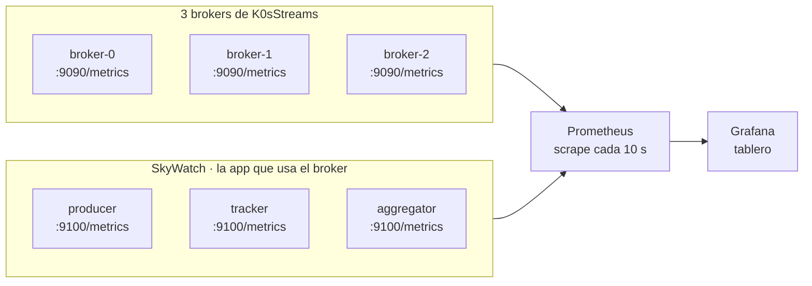

# Observabilidad: ver el broker funcionando

Este documento explica cómo K0sStreams publica métricas, cómo Prometheus las junta y cómo el
tablero de Grafana las muestra. Sirve para dos cosas: entender el sistema desde afuera mientras
corre, y tener algo concreto que mostrar en la defensa.

La idea de fondo: **un sistema distribuido solo se entiende cuando se lo ve moverse**. Que haya
tres brokers, que uno tenga el Lease, que las réplicas estén al día y que la aplicación de arriba
sobreviva a que se caiga el líder son afirmaciones del diseño. El tablero las convierte en algo
observable.

---

## 1. Cómo encaja todo



Tres piezas, cada una con una responsabilidad:

| Pieza | Qué hace |
| --- | --- |
| **El broker** | Expone `/metrics` en el puerto 9090, el mismo de la API REST, en formato Prometheus. |
| **Prometheus** | Cada 10 segundos le pide `/metrics` a cada pod y guarda la serie temporal. |
| **Grafana** | Le pregunta a Prometheus y dibuja el tablero. |

No hay base de datos de métricas en el broker ni nada que se escriba a disco: las métricas se
calculan en el momento del scrape y se devuelven en texto plano.

---

## 2. Qué publica el broker

Cada bloque mide lo suyo con su propio `Meter` interno; el host los registra a todos. Hoy el
Broker publica el estado del cluster:

| Métrica | Qué significa |
| --- | --- |
| `k0sstreams_broker_is_leader` | `1` si este broker tiene el Lease, `0` si no. |
| `k0sstreams_leader_epoch` | La época que ve este broker. Sube de a uno en cada cambio de líder y **nunca baja**: es el fencing. |
| `k0sstreams_topic_high_watermark` | Último offset confirmado por quórum, por tópico. |
| `k0sstreams_topic_end_offset` | Último offset en el disco **de este broker**, por tópico. Siempre igual o mayor que el anterior: la diferencia es lo escrito que todavía espera quórum. |

Todas llevan la etiqueta `node` con el nombre del pod, y las de tópico además `topic`.

A eso se suman las **métricas HTTP que ASP.NET Core ya trae**
(`http_server_request_duration_seconds`), con la ruta, el método y el código de respuesta. No
escribimos contadores propios para la API: con esas ya se ven los 200, los 307 (un seguidor
redirigiendo al líder) y los 503 (nadie sabe quién lidera).

### Decisiones de diseño

- **Son gauges observables.** No cuestan nada hasta que Prometheus hace un scrape; recién ahí se
  leen de `IClusterState`, `ITopicCatalog` e `ILog`, que ya están en memoria. Nada en el camino
  caliente (append, fsync, receive).
- **Medir nunca puede romper nada.** Si un tópico no se puede leer, el gauge lo saltea, lo deja en
  el log y sigue con los demás. Un scrape que falla no puede tirar el broker.
- **Sin etiquetas de alta cardinalidad.** Nada de offsets, ids de consumidor ni claves de mensaje
  como etiqueta: cada valor distinto crea una serie nueva y eso hace explotar a Prometheus. Tópico
  y cola sí, porque son pocos y acotados.
- **`Contracts` no se tocó.** Cada bloque puede agregar su propio `Meter` dentro de su proyecto y
  el Broker lo registra con `AddMeter`.

### Qué falta (y dónde seguiría)

Esto cubre el estado del cluster. Lo que cada bloque podría medir de lo suyo:

| Bloque | Métricas pendientes |
| --- | --- |
| A · Almacenamiento | duración del fsync, registros por fsync (el group commit en acción), segmentos borrados por retención |
| B · Cola | receives, acks, nacks, DLQ, reentregas, atraso de cada cola |
| C · Replicación | espera del quórum, timeouts, atraso de cada seguidor visto desde el líder, rechazos por motivo |
| D · Coordinación | cuánto tarda la promoción de un líder nuevo |

---

## 3. Qué publica SkyWatch

SkyWatch es la aplicación que corre **sobre** K0sStreams, y expone sus propias métricas en el
puerto **9100**:

| Métrica | Qué significa |
| --- | --- |
| `skywatch_positions_published_total` | Posiciones de avión que el producer publicó. |
| `skywatch_positions_consumed_total` | Posiciones que los consumidores leyeron. |
| `skywatch_alerts_published_total` | Alertas que publicó el tracker. |
| `skywatch_stats_published_total` | Estadísticas que publicó el aggregator. |
| `skywatch_errors_total` | Errores. Tiene que quedarse en cero. |

> **Ojo con un número que confunde:** *consumidas* suele ser **el doble** de *publicadas*. No es un
> error. Son dos colas independientes (el tracker y el aggregator) y **cada cola recibe todos los
> mensajes del tópico**. Es el diseño de K0sStreams y es lo que lo diferencia de un reparto de
> carga entre consumidores.

---

## 4. Cómo encuentra Prometheus a quién scrapear

No hay `ServiceMonitor` ni `PodMonitor` porque el cluster no tiene prometheus-operator. Se usan
dos mecanismos, en `deploy/monitoring/prometheus.yaml`:

**Job `kubernetes-pods`** — scrapea cualquier pod que tenga estas anotaciones, que el broker ya
trae en `deploy/broker.yaml` y en el chart:

```yaml
prometheus.io/scrape: "true"
prometheus.io/port: "9090"
prometheus.io/path: "/metrics"
```

**Job `skywatch`** — los pods de SkyWatch **no** llevan esas anotaciones y sus manifiestos son de
otro equipo, así que se los busca por su etiqueta `app` (`skywatch-producer`, `-tracker`,
`-aggregator`) y se les fija el puerto 9100. Así no hay que pedirle nada a nadie, y además alcanza
a los dos namespaces (`skywatch-k0sstreams` y `skywatch-kafka`): se puede comparar la misma
aplicación corriendo sobre nuestro broker y sobre Kafka.

---

## 5. El tablero

Está en `deploy/grafana/k0sstreams-dashboard.json`. Son 16 paneles en 4 filas.

| Fila | Qué cuenta |
| --- | --- |
| **Coordinación** | Quién manda: líder actual, franja por broker, época y cuántos brokers responden (el quórum es 2 de 3). |
| **Replicación** | Hasta dónde llegó cada log: high watermark y end offset de los 3 brokers superpuestos, atraso de cada uno y registros confirmados por segundo. |
| **API** | Pedidos por segundo por ruta y código, latencia de publicar (p50/p95), redirecciones 307 y rechazos 503, y carga por broker. |
| **SkyWatch** | La aplicación: publicadas contra consumidas, acumulado, alertas y estadísticas, y errores. |

El panel de **atraso de cada broker** no viene de una métrica nueva: se calcula en el tablero
restando el end offset de cada broker al del más adelantado.

```promql
max by (topic) (k0sstreams_topic_end_offset)
  - on (topic) group_right () k0sstreams_topic_end_offset
```

---

## 6. Cómo desplegarlo

### En el cluster

```bash
cd <raíz del repo>
export KUBECONFIG=~/.kube/k0s-catedra.yaml

# 1. Brokers con la imagen que expone /metrics
helm upgrade k0sstreams deploy/helm/k0sstreams -n k0sstreams \
  --set image.repository=paulisuden2/k0sstreams-broker --set image.tag=metrics

# 2. Prometheus
kubectl apply -f deploy/monitoring/prometheus.yaml
kubectl -n k0sstreams rollout restart deploy/prometheus   # no relee el ConfigMap solo

# 3. El tablero (el mismo comando sirve para actualizarlo)
kubectl -n k0sstreams create configmap grafana-dashboards \
  --from-file=deploy/grafana/k0sstreams-dashboard.json \
  --dry-run=client -o yaml | kubectl apply -f -

# 4. Grafana
kubectl apply -f deploy/monitoring/grafana.yaml

# La URL
kubectl -n k0sstreams get svc grafana -o jsonpath='{.status.loadBalancer.ingress[0].ip}'
```

Grafana entra sin usuario (rol `Viewer`) y abre el tablero como página de inicio. Para editar,
`admin` / `admin`.

### En minikube, sin depender del cluster

```bash
minikube start --driver=docker --memory=3g --cpus=3
minikube image build -t k0sstreams/broker:dev .
kubectl apply -f deploy/
kubectl create namespace k0sstreams
kubectl apply -f deploy/monitoring/prometheus.yaml
kubectl -n k0sstreams create configmap grafana-dashboards \
  --from-file=deploy/grafana/k0sstreams-dashboard.json --dry-run=client -o yaml | kubectl apply -f -
kubectl apply -f deploy/monitoring/grafana.yaml
kubectl -n k0sstreams port-forward svc/grafana 3000:80
```

Después, `http://localhost:3000/d/k0sstreams-broker`.

> Minikube es un solo nodo, así que los tres brokers caen en la misma máquina. La elección por
> Lease y el failover se ven igual; lo que no se puede demostrar es perder un nodo entero con su
> disco.

### Comprobar que el scrape anda

```bash
kubectl -n k0sstreams port-forward svc/prometheus 9090:9090
# http://localhost:9090/targets
```

Tienen que estar los 3 brokers en el job `kubernetes-pods` y los 3 servicios de SkyWatch en el job
`skywatch`, todos en `UP`.

---

## 7. La demo: matar al líder

```bash
LIDER=$(kubectl -n k0sstreams get lease k0sstreams-leader -o jsonpath='{.spec.holderIdentity}')
echo "matando a $LIDER"
kubectl -n k0sstreams delete pod $LIDER
```

Qué mirar, en orden:

| # | Panel | Qué pasa |
| --- | --- | --- |
| 1 | **Líder actual** | cambia de nombre en ~1 segundo |
| 2 | **Líder por broker** | la franja verde salta de un pod a otro |
| 3 | **Época** | escalón hacia arriba. El líder viejo que vuelva trae una época menor y se le rechazan las escrituras: eso es el fencing |
| 4 | **Redirecciones 307 / rechazos 503** | pico corto: unos segundos sin líder, en los que los clientes reciben redirecciones o rechazos, **nunca datos corruptos** |
| 5 | **SkyWatch · acumulado** | se aplana un segundo y retoma. **No se perdió nada, solo se demoró** |
| 6 | **Atraso de cada broker** | sube en el que reinició y vuelve a 0 cuando se pone al día |

El remate de la demo es el punto 5: **se mató un nodo del sistema distribuido y la aplicación de
arriba no se enteró.**

El tablero refresca cada 10 segundos y el failover tarda ~1 segundo, así que se puede pasar
desapercibido en vivo. No importa: el escalón de la época y la franja del líder quedan dibujados
en el histórico.

---

## 8. Cosas que nos costaron y conviene no repetir

Cada una de estas rompía la observabilidad de una forma distinta y ninguna era obvia.

### `/health` corría también el chequeo de readiness

Los dos endpoints ejecutaban todas las comprobaciones, así que un broker esperando la elección
devolvía 503 en el **liveness** y Kubernetes lo reiniciaba antes de que llegara a liderar. Los
pods del cluster acumulaban decenas de reinicios. Ahora `/health` corre solo `live` y `/ready`
solo `ready`, filtrando por tag.

### Los discos del cluster son lentísimos

En los nodos de la cátedra, cada `fsync` tarda unos **3 segundos**. Eso explica tres síntomas a la
vez: Grafana tardando media hora en arrancar (corre ~800 migraciones de SQLite, cada una con su
commit), el CSI de Cinder reiniciándose, y **etcd caído** — etcd hace un `fsync` por escritura y
necesita milisegundos.

Antes de culpar a un manifiesto, chequear:

```bash
kubectl get --raw '/readyz?verbose' | grep etcd
```

Si dice `[-]etcd failed`, el problema es el cluster. Con etcd caído el API server se cuelga y los
controladores no procesan nada: un Deployment se queda con `observedGeneration: <none>`.

> Durante esas horas la época del Lease llegó a **1491**: cada vez que el líder no podía renovar,
> bajaba y otro lo tomaba. En minikube, con el mismo código, iba por la 6. La época altísima es
> síntoma del cluster, no del broker.

### El tmpfs de Grafana se llevó puesto el plugin de Prometheus

Para esquivar los discos lentos pusimos la base de Grafana en memoria. Pero se montó sobre
`/var/lib/grafana`, que **también es el directorio de plugins** (`GF_PATHS_PLUGINS`), y con un
tope de 128 MiB. Grafana instala ~458 MiB de plugins al arrancar: el tmpfs se llenó, la copia se
cortó a la mitad y el plugin de Prometheus fue de los que no entraron. Resultado: el datasource
existía pero **todos los paneles decían "No data"**.

La corrección separa las dos cosas: `GF_PATHS_DATA` apunta a un directorio propio con el tmpfs
(solo la base, unos 5 MB) y `GF_PATHS_PLUGINS` se queda en el disco del contenedor.

**Kubernetes nunca copia el contenido de la imagen dentro de un `emptyDir`: lo tapa.** Montar un
volumen sobre un directorio que la imagen usa lo deja vacío.

### Las variables del tablero sin valor por defecto

El tablero usa una variable de tipo `datasource`. Sin un valor inicial, Grafana la dejaba vacía y
cada panel consultaba un datasource inexistente. Ahora arranca apuntando al uid `prometheus`, que
es el que fija el provisioning.

> Y un detalle que confunde: si la URL del navegador trae `&var-datasource=`, **ese parámetro vacío
> pisa el valor por defecto**. Entrar por `http://<grafana>/d/k0sstreams-broker`, limpio.

### La imagen de SkyWatch no exponía métricas

Los pods desplegados no tenían **ningún** puerto escuchando. La imagen era anterior al commit que
agrega `AddSkyWatchObservability`. Además faltaba inyectar la IP del pod: el listener escucha en
`Observability:Host` y, si está vacío, en `POD_IP`; sin ninguno de los dos cae en `localhost`, que
desde afuera del pod no se alcanza.

Pendiente para el equipo de SkyWatch, en `cluster_k0s/08_skywatch`:

1. Reconstruir y publicar las tres imágenes desde `main`.
2. Agregar a los tres Deployments:

```yaml
          env:
            - name: Observability__Host
              valueFrom:
                fieldRef:
                  fieldPath: status.podIP
```

Mientras tanto quedó parcheado en vivo con `kubectl patch`, **lo que se pierde al volver a correr
su script de despliegue**.

### La dirección del líder, corta contra completa

`deploy/broker.yaml` anuncia al líder como `http://{0}.broker:9090`. Ese nombre corto **solo
resuelve desde el mismo namespace**, así que una aplicación en otro namespace que siga el redirect
307 no encuentra al líder. El chart de Helm ya usa el FQDN completo y no tiene el problema; los
manifiestos sueltos sí. Si se usan fuera de una prueba local, conviene igualarlos.

---

## 9. Dónde está cada cosa

| Archivo | Qué es |
| --- | --- |
| `src/K0sStreams.Broker/ClusterMetrics.cs` | Los cuatro gauges del estado del cluster. |
| `src/K0sStreams.Broker/MetricsExtensions.cs` | Registra el exportador Prometheus y los `Meter` de cada bloque. |
| `tests/K0sStreams.Broker.Tests/MetricsEndpointTests.cs` | Verifica que `GET /metrics` devuelve las series. |
| `tests/K0sStreams.Broker.Tests/HealthProbesTests.cs` | Verifica que `/health` pasa y `/ready` falla sin líder. |
| `deploy/monitoring/prometheus.yaml` | Prometheus, su RBAC de solo lectura y los dos jobs de scrape. |
| `deploy/monitoring/grafana.yaml` | Grafana con el datasource y el tablero provisionados. |
| `deploy/monitoring/README.md` | Instalación paso a paso y límites conocidos. |
| `deploy/grafana/k0sstreams-dashboard.json` | El tablero. Una sola copia: se importa a mano o se provisiona. |

---

## 10. Límites conocidos

- **Prometheus y Grafana guardan sus datos en memoria** (`emptyDir`), con 6 horas de retención.
  Si se reinicia el pod, se pierde el histórico. Para la demo alcanza y evita depender del CSI,
  que en este cluster viene fallando. Para algo serio, un PVC.
- **El `ClusterRole` de Prometheus es de lectura pero alcanza a todo el cluster**, porque el
  descubrimiento de pods necesita listar pods de cualquier namespace.
- **Los gauges por tópico recorren el catálogo en cada scrape.** La primera vez que se mira un
  tópico que este broker no abrió, lo abre (lo recupera de disco). Con pocos tópicos es
  despreciable; con cientos habría que medir.
- **La etiqueta `otel_scope_name`** aparece en todas las series: la agrega el exportador de
  OpenTelemetry. Es inofensiva, pero conviene no sorprenderse al verla.
