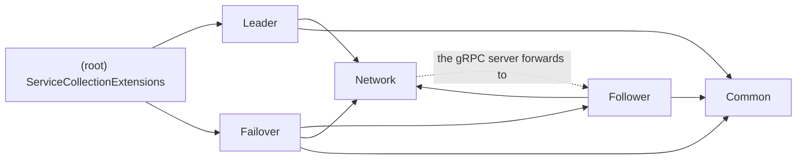

# Replication (block C): code map

What lives where in this project. For the design, see [docs/replication.md](../../docs/replication.md). For a guide to each class, see [docs/replication-code-guide.md](../../docs/replication-code-guide.md).

## Folders

| Folder | What it does | Start with | Phase |
| --- | --- | --- | --- |
| *(root)* | What the broker host calls, and every setting | `ServiceCollectionExtensions`, `ReplicationOptions` | — |
| `Follower/` | Answers other brokers: checks and writes the leader's records, serves `Fetch`, `GetState` and `ListTopics` | `AppendHandler`, `ReplicationNode` | 2 |
| `Leader/` | Sends records to the followers, waits for a majority, advances the high watermark | `QuorumReplicator` → `TopicReplication`, `PeerReplicator` | 3 |
| `Failover/` | Gets a new leader ready without losing a confirmed record | `LeaderPromotion` → `PeerSurvey`, `LogCatchUp`, `EpochChangeWriter` | 4 |
| `Network/` | How brokers reach each other: the `IReplicationPeer` seam and gRPC (client and server) | `IReplicationPeer`, `GrpcReplicationPeer`, `ReplicationGrpcService` | 2 |
| `Common/` | Small pieces the others share | `EpochTracker`, `KnownTopics`, `LogTip`, `Backoff`, `SingleLog` | — |

The tests in `tests/K0sStreams.Replication.Tests` use the same folders. The test helpers are in `Support/`.

## A write, end to end

1. **On the leader,** B appends the record to the log and calls `IReplicator.WaitForQuorumAsync`, which is `Leader/QuorumReplicator`.
2. **Sending.** `Leader/PeerReplicator`, one per follower, sends it with `Append` through `Network/GrpcReplicationPeer`.
3. **On a follower,** `Network/ReplicationGrpcService` passes the request to `Follower/ReplicationNode`, and `Follower/AppendHandler` checks it and writes it.
4. **Back on the leader,** `Leader/TopicReplication` counts the copies. Once a majority has the record, it advances the high watermark, and the wait completes.

On a failover, D calls `ILeaderPromotion`, which is `Failover/LeaderPromotion`, before announcing the new leader.

## Who depends on whom

Each file's `using K0sStreams.Replication.…` lines show which folders it uses.

Nothing depends on `Leader/` or `Failover/` except the registration, so each of those can be read on its own.

## Where to start reading

1. `Network/IReplicationPeer.cs`: the four operations between brokers.
2. `Follower/AppendHandler.cs`, with `Follower/AppendHandlerTests.cs`: what a follower does with records, and every check.
3. `Leader/QuorumReplicator.cs`, then `TopicReplication.cs` and `PeerReplicator.cs`, with `Leader/QuorumReplicatorTests.cs`.
4. `Failover/LeaderPromotion.cs`, then its three steps, with `Failover/LeaderPromotionTests.cs`.
5. `ServiceCollectionExtensions.cs`: how it's all wired into the broker.
